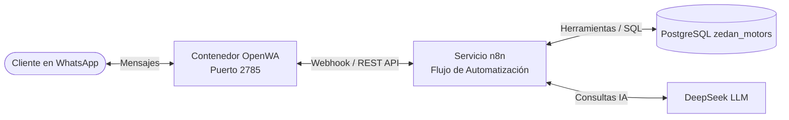

# Guía de Instalación, Configuración y Ejecución de OpenWA
## Proyecto: Zedan Motors - Taller Mecánico Especializado

Esta guía documenta detalladamente cómo se diseñó, instaló, configuró y ejecutó el servicio de **OpenWA (WA-Automate Gateway)** en el ecosistema de **Zedan Motors**, explicando tanto la arquitectura implementada mediante contenedores como su integración con **n8n** y la alternativa de ejecución local.

---

## 1. ¿Qué es OpenWA y cuál es su rol en Zedan Motors?

**OpenWA** (construido sobre `@open-wa/wa-automate`) es una pasarela (gateway) API REST y WebSocket autónoma que permite interactuar con la plataforma de WhatsApp Web mediante un navegador headless (Chromium) automatizado con Puppeteer.

En **Zedan Motors**, OpenWA cumple la función de **conector conversacional principal**:
1. **Recepción de mensajes (Inbound):** Escucha eventos de mensajes entrantes de los clientes y los retransmite mediante Webhooks al motor de flujos en **n8n**.
2. **Procesamiento con IA:** El agente de IA (DeepSeek) analiza la intención (agendar cita, consultar citas por placa/cédula, verificar inventario o servicios).
3. **Envío de respuestas (Outbound):** Envía las respuestas generadas por el Agente IA de vuelta al chat de WhatsApp del cliente.



---

## 2. Decisión de Arquitectura: ¿Por qué Docker en lugar de instalación local directa?

Para ejecutar Puppeteer / Chromium en sistemas Windows de forma productiva o en equipo de desarrollo, una instalación directa con `npm` suele presentar complicaciones como:
- Conflictos de versiones de Node.js y dependencias nativas compiladas en C++.
- Descarga y rutas variables de Google Chrome / Chromium.
- Procesos huérfanos de Chrome en segundo plano que consumen memoria.
- Pérdida de sesión al reiniciar terminales o cambiar de usuario.

**Solución adoptada:** Se implementó la imagen de contenedor preconstruida `ghcr.io/rmyndharis/openwa:latest`, la cual:
- Viene con Chromium headless optimizado para Linux.
- Cuenta con un Dashboard web para monitoreo y escaneo de códigos QR.
- Ofrece compatibilidad nativa 1:1 con el nodo comunitario de n8n `@rmyndharis/n8n-nodes-openwa`.
- Persiste las credenciales y tokens de sesión en un volumen montado del host (`./openwa-data`).

---

## 3. Especificación Técnica en `docker-compose.yml`

El servicio de OpenWA quedó configurado en el archivo orquestador [docker-compose.yml](file:///c:/Users/taich/Downloads/Zedan-Motors/docker-compose.yml) con los siguientes parámetros:

```yaml
  # ========================================================
  # OpenWA - API WhatsApp & Dashboard para n8n
  # (Gateway oficial para @rmyndharis/n8n-nodes-openwa)
  # ========================================================
  openwa:
    image: ghcr.io/rmyndharis/openwa:latest
    container_name: zedan-openwa
    restart: unless-stopped
    ports:
      - "${OPENWA_PORT:-2785}:2785"
    environment:
      - PORT=2785
      - NODE_ENV=development
      - DATABASE_TYPE=sqlite
      - DATABASE_SYNCHRONIZE=true
      - AUTO_START_SESSIONS=true
      - CSP_UPGRADE_INSECURE_REQUESTS=false
    volumes:
      # Persistencia de base de datos SQLite, sesiones de WhatsApp y tokens
      - ./openwa-data:/app/data
    networks:
      - zedan-net
```

### Explicación de los parámetros clave:
| Variable / Parámetro | Propósito |
| :--- | :--- |
| `image: ghcr.io/rmyndharis/openwa:latest` | Imagen que contiene el servidor HTTP/WS de OpenWA y Chromium preinstalado. |
| `ports: ["${OPENWA_PORT:-2785}:2785"]` | Expone el puerto `2785` en la máquina local para acceder al dashboard y API REST. |
| `AUTO_START_SESSIONS=true` | Si el contenedor se reinicia, reanuda automáticamente las sesiones activas sin pedir re-escanear el código QR. |
| `volumes: - ./openwa-data:/app/data` | Mapea la carpeta local `./openwa-data` hacia `/app/data` del contenedor, conservando la base SQLite de sesiones y los archivos temporales de WhatsApp. |
| `networks: - zedan-net` | Permite que **n8n** se comunique con OpenWA a través del nombre de host interno `http://openwa:2785`. |

---

## 4. Paso a Paso de Instalación y Puesta en Marcha

### Paso 1: Configurar las Variables de Entorno
En el archivo [.env](file:///c:/Users/taich/Downloads/Zedan-Motors/.env) del proyecto se definió el puerto de OpenWA:
```env
# OpenWA (WhatsApp API & Dashboard)
OPENWA_PORT=2785
```

### Paso 2: Crear el directorio de datos persistentes
Se generó la carpeta en la raíz del proyecto para alojar la sesión:
```powershell
mkdir -p openwa-data
```

### Paso 3: Descargar y levantar el contenedor
Se ejecutó el comando de Docker Compose para descargar la imagen y poner en marcha el servicio en segundo plano:
```powershell
docker compose up -d openwa
```
*(Opcionalmente, para levantar todo el ecosistema completo: `docker compose up -d`)*

### Paso 4: Vincular el número de WhatsApp (Escaneo de QR)
Existen dos formas de vincular la cuenta:

#### Opción A: A través del Dashboard Web (Recomendada)
1. Abrir en el navegador: [http://localhost:2785](http://localhost:2785)
2. Se accede a la interfaz gráfica de administración de OpenWA.
3. Se crea o inicia una sesión (por ejemplo, llamada `default` o `zedan`).
4. En pantalla se desplegará el código QR en tiempo real.
5. En el teléfono móvil: **WhatsApp > Dispositivos vinculados > Vincular un dispositivo** y escanear el código QR en pantalla.

#### Opción B: A través de la consola / logs de Docker
Si se prefiere hacerlo por línea de comandos:
```powershell
docker logs -f zedan-openwa
```
El log renderizará un código QR en caracteres ASCII en la terminal para ser escaneado directamente.

Una vez escaneado, la consola confirmará el estado:
```text
Session "default" is CONNECTED
```

---

## 5. Integración con el Flujo de n8n

Para que el Agente de IA pueda interactuar con WhatsApp, se conectó OpenWA con n8n mediante los siguientes pasos:

### 1. Instalación del nodo comunitario en n8n
1. Ingresar a [http://localhost:5678](http://localhost:5678)
2. Ir a **Settings** (⚙️) > **Community Nodes** > **Install**.
3. Ingresar el nombre del paquete:
   ```text
   @rmyndharis/n8n-nodes-openwa
   ```
4. Confirmar la instalación y esperar a que n8n cargue los nodos `OpenWA Trigger` y `OpenWA Send`.

### 2. Configurar la Credencial `OpenWA Account` en n8n
Dentro de n8n, se creó una credencial de tipo **OpenWA API**:
- **Base URL:** `http://openwa:2785` *(uso de la red interna Docker `zedan-net`)* o `http://localhost:2785`
- **Session Name:** `default` (o el nombre asignado en el dashboard).

### 3. Conexión en el Workflow
En el archivo [n8n/workflow_zedan_motors.json](file:///c:/Users/taich/Downloads/Zedan-Motors/n8n/workflow_zedan_motors.json):
- El nodo **OpenWA Trigger** recibe los mensajes entrantes y los formatea con la sesión `sessionId = from`.
- El flujo envía el texto al **AI Agent Zedan**.
- El nodo **OpenWA Send** (`@rmyndharis/n8n-nodes-openwa.openWa`) despacha la respuesta hacia el `chatId` del cliente.

---

## 6. Alternativa: Ejecución Local Directa con Node.js (Sin Docker)

Si en algún entorno no se dispone de Docker, OpenWA también puede ejecutarse de manera autónoma con Node.js y npm:

### Instalación global o mediante npx:
```powershell
# Opción 1: Instalar globalmente el CLI de OpenWA
npm install -g @open-wa/wa-automate

# Opción 2: Ejecutar directamente el servidor API
npx @open-wa/wa-automate --port 2785 --session-data-path ./openwa-data --multi-device true --auto-refresh-qr
```

### Ejecución programática en un script Node.js (`test-openwa.js`):
```javascript
import { create, Client } from '@open-wa/wa-automate';

create({
  sessionId: "ZEDAN_MOTORS",
  multiDevice: true,
  authTimeout: 60,
  blockCrashLogs: true,
  headless: true,
  qrTimeout: 0,
}).then((client) => start(client));

function start(client) {
  client.onMessage(async (message) => {
    if (message.body === 'Hola') {
      await client.sendText(message.from, '¡Hola! Bienvenido a Zedan Motors. ¿En qué podemos ayudarte hoy?');
    }
  });
}
```

---

## 7. Mantenimiento y Comandos de Diagnóstico

| Acción | Comando |
| :--- | :--- |
| **Ver logs del servicio en vivo** | `docker logs -f zedan-openwa` |
| **Reiniciar el contenedor** | `docker restart zedan-openwa` |
| **Detener el servicio** | `docker stop zedan-openwa` |
| **Cerrar o renovar sesión** | Eliminar el contenido dentro de `./openwa-data/` y reiniciar el contenedor para generar un nuevo código QR. |
| **Verificar estado de puertos** | `netstat -ano | findstr 2785` |

---

## 8. Conclusión

La instalación y ejecución de **OpenWA** en **Zedan Motors** se realizó bajo una arquitectura de microservicios contenerizada que garantiza:
- **Alta disponibilidad:** Reconexión automática tras reinicios sin pérdida de credenciales.
- **Seguridad y aislamiento:** Comunicación interna en la red virtual de Docker (`zedan-net`) con n8n.
- **Mantenibilidad:** Separación clara entre el motor de WhatsApp, la base de datos PostgreSQL, el backend y los flujos de IA.
